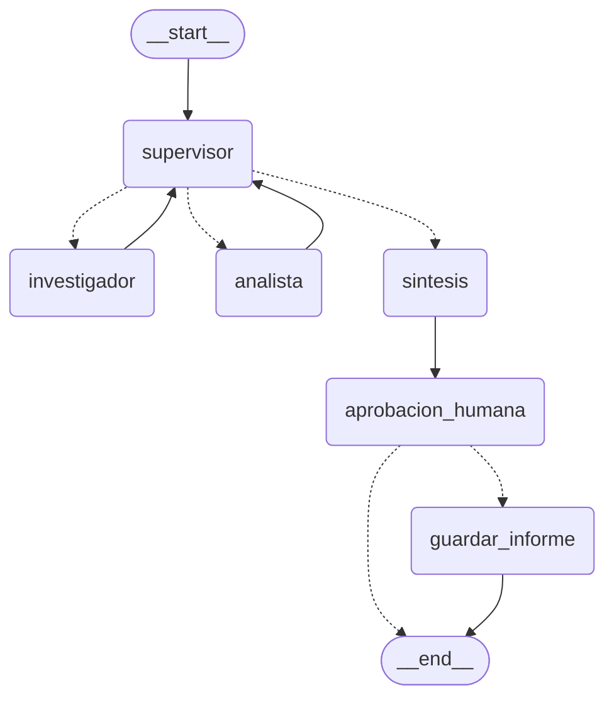

# API de producción para el orquestador multi-agente

API REST asíncrona (FastAPI) que expone el orquestador multi-agente de la Pre-entrega 6. Recibe consultas, las encola en Redis y las procesa en segundo plano. Las trazas de cada ejecución van a LangSmith, y antes de la acción crítica (guardar el informe) el grafo se pausa hasta recibir aprobación humana.

Pre-entrega 7 — IA Engineering.

## Arquitectura

```
Cliente ──POST /tasks──▶ API ──estado PENDING + encolar──▶ Redis (cola + estado de jobs)
   │                      └── responde al instante con job_id
   │
   │        Workers (5, mismo event loop) ──BLPOP──▶ ejecutan el grafo ──▶ actualizan el estado
   │                                                   │
   │                                                   └── checkpoints de LangGraph ──▶ Redis (RedisSaver)
   │                                                   └── trazas ──▶ LangSmith
   │
   ├──GET /tasks/{id}──────────▶ estado del job
   └──POST /tasks/{id}/approve─▶ encola la reanudación
```

### Grafo



El orquestador de la Pre-entrega 6 (supervisor, investigador, analista y síntesis) queda igual. Lo nuevo son los nodos `aprobacion_humana` y `guardar_informe`.

## Estructura

```
app/
├── main.py           # FastAPI: POST /tasks, GET /tasks/{id}, arranque de workers
├── graph.py          # orquestador de la Pre-entrega 6 + nodos HITL + checkpointer
├── worker.py         # ejecuta/reanuda el grafo y actualiza el estado en Redis
├── jobs.py           # estado de los jobs y cola en Redis
├── observability.py  # configuración de LangSmith y @traceable
├── hitl.py           # nodo de aprobación (interrupt) + POST /tasks/{id}/approve
├── state.py          # estado compartido del grafo
├── agents/           # supervisor, investigador, analista y síntesis (Pre-entrega 6)
├── rag_system.py     # RAG híbrido de la Pre-entrega 4
├── config.py
└── llm.py
scripts/prueba_carga.py  # 5 peticiones concurrentes
docker-compose.yml       # Redis Stack
screenshots/             # capturas de LangSmith
informes/                # informes aprobados
```

## Endpoints

| Método | Ruta | Qué hace |
|---|---|---|
| `POST` | `/tasks` | Crea el job, lo encola y devuelve `job_id` con `202 Accepted` |
| `GET` | `/tasks/{job_id}` | Estado del job (y borrador o resultado, según el caso) |
| `POST` | `/tasks/{job_id}/approve` | Aprueba o rechaza el informe: `{"aprobado": true, "comentario": "..."}` |
| `GET` | `/health` | Verifica la conexión con Redis |

### Estados de un job

```
PENDING → RUNNING → WAITING_APPROVAL → (approve) → PENDING → RUNNING → DONE
              └──────────── excepción en cualquier punto ────────────▶ FAILED
```

- `WAITING_APPROVAL` incluye el `borrador` del informe para que el revisor lo lea.
- `DONE` incluye `resultado`, `aprobado` e `informe_path` (vacío si se rechazó).
- `FAILED` incluye `error`. El worker captura cualquier excepción del agente y actualiza el estado, así el cliente no queda haciendo polling para siempre.

## Decisiones de diseño

### API asíncrona sin bloquear el event loop

- `POST /tasks` solo escribe en Redis y encola: responde en milisegundos, sin esperar al agente.
- Todo el acceso a Redis usa el cliente asíncrono (`redis.asyncio`) y el grafo se ejecuta con `ainvoke`.
- Las partes sync se mandan a un thread: la carga del RAG (modelo de embeddings y BM25) al iniciar, la búsqueda del investigador (LangChain ejecuta las herramientas sync en un thread) y la escritura del informe (`asyncio.to_thread`).
- Los workers corren en el mismo event loop que la API. La cantidad se configura con `WORKERS` (por defecto, `1`). La API recibe y encola pedidos concurrentemente; el worker los procesa de a uno con esta configuración.

### Procesamiento de jobs y cuota del LLM

`WORKERS=1` es el valor predeterminado para evitar que varios jobs llamen al modelo simultáneamente. La API sigue aceptando y encolando peticiones concurrentes, pero un worker procesa los jobs de a uno. Esto **no limita por sí solo** la cantidad de llamadas por minuto: la cuota del proveedor puede seguir causando errores `429 RESOURCE_EXHAUSTED`, como ocurrió en la corrida documentada abajo. Para evitar esos errores se necesita respetar la cuota configurada para la cuenta/modelo o implementar un limitador de llamadas.

### Redis con dos usos

- **Estado de los jobs y cola:** claves `job:{id}` (JSON) y la lista `tasks_queue` (`RPUSH` + `BLPOP`).
- **Checkpoints de LangGraph:** `AsyncRedisSaver` guarda el estado del grafo después de cada nodo, con `thread_id = job_id`. Es lo que permite pausar en el HITL y reanudar más tarde, incluso desde otro worker o después de reiniciar la API. Necesita **Redis Stack** (o Redis 8+) por los módulos de búsqueda y JSON.

### Human-in-the-loop

**Criterio de tarea crítica:** guardar el informe es la única acción del sistema con efecto secundario (escribe un archivo fuera del grafo), así que siempre requiere aprobación.

- `aprobacion_humana` llama a `interrupt()` con el borrador. El grafo se detiene y el checkpoint queda en Redis.
- `POST /tasks/{id}/approve` no reanuda directamente: encola la reanudación, igual que una tarea nueva, para no bloquear la API.
- El worker reanuda con `Command(resume={...})`. Si se aprobó, pasa por `guardar_informe`; si se rechazó, termina sin guardar.
- Aprobar un job que no está en `WAITING_APPROVAL` devuelve `409`.
- Al reanudar, LangGraph vuelve a ejecutar el nodo desde el principio, por eso no hay ningún efecto secundario antes del `interrupt()`.

### Observabilidad con LangSmith

- Con `LANGSMITH_TRACING=true`, LangChain y LangGraph envían automáticamente cada nodo, llamada al LLM, herramienta y retriever.
- `procesar_job` está decorada con `@traceable`, así cada job aparece como una traza que contiene todo el grafo.
- Cada ejecución lleva `job_id` y `accion` (`iniciar` o `reanudar`) como metadata y tags, para filtrar en el dashboard.

## Cómo levantar el entorno

Requisitos: Python 3.12+, Docker, una API key de Gemini, una de LangSmith y el índice `fastapi-docs-rag` de la Pre-entrega 4 cargado en Pinecone.

### 1. Redis Stack

```bash
docker compose up -d
```

### 2. Entorno de Python

```bash
python -m venv .venv
source .venv/Scripts/activate   # Git Bash en Windows
# .venv\Scripts\activate        # PowerShell / CMD
# source .venv/bin/activate     # Mac / Linux
pip install -r requirements.txt
```

### 3. Configuración

- Copiar `.env.example` como `.env` y completar `GOOGLE_API_KEY`, `PINECONE_API_KEY` y `LANGSMITH_API_KEY`.
- Copiar `chunks.json` de la Pre-entrega 4 a la raíz del repo (lo necesita BM25).

### 4. API

```bash
uvicorn app.main:app
```

La documentación interactiva queda en `http://localhost:8000/docs`.

## Prueba manual

1. `POST /tasks` con `{"query": "Según la documentación de FastAPI, ¿qué campos tiene el modelo Item? Validá si {\"name\": \"Teclado\", \"price\": 45.2} es válido."}` → copiar el `job_id`.
2. `GET /tasks/{job_id}` hasta que llegue a `WAITING_APPROVAL` y leer el `borrador`.
3. `POST /tasks/{job_id}/approve` con `{"aprobado": true}`.
4. `GET /tasks/{job_id}` → `DONE`, con el informe guardado en `informes/`.

## Prueba de carga: 5 peticiones concurrentes

Con la API levantada, en otra terminal:

```bash
python scripts/prueba_carga.py --aprobar
```

Envía 5 consultas distintas al mismo tiempo, espera a que lleguen a `WAITING_APPROVAL`, las aprueba y espera a que terminen. Sin `--aprobar`, quedan pausadas para aprobarlas a mano.

## Evidencia en LangSmith

Corrida de carga: 5 peticiones concurrentes con `python scripts/prueba_carga.py --aprobar`, realizada con la configuración inicial (`WORKERS=5`, sin limitador). Las capturas de esa corrida están en `screenshots/`:

| Captura | Qué muestra |
|---|---|
| `dashboard.png` | Resumen del proyecto: trazas, tasa de error, llamadas al modelo y a herramientas, tokens y **costo total** |
| `traces.png` | Lista de las 6 trazas de la corrida, con estado y latencia; también se ve un error por límite de cuota |
| `latencia.png` | Percentiles de latencia P50 y P99 que muestra LangSmith |
| `example_job.png` | Detalle de una ejecución fallida por `GoogleRateLimitError` |

### Lectura del dashboard

**Resumen de la corrida**

| Métrica | Valor |
|---|---|
| Trazas | 6 (5 `iniciar` + 1 `reanudar`) |
| Tasa de error | 66,67% (4 de 6 trazas) |
| Llamadas al LLM (`gemini-3.5-flash`) | 16 |
| Llamadas a herramientas | 4 (2 `buscar_documentacion_fastapi`, 2 `validar_json_contra_esquema`) |
| Tokens totales | 18,5K (≈ 1.150 por llamada al LLM) |
| Costo total | USD 0,07 |
| Costo promedio por petición enviada | ≈ USD 0,014 (0,07 / 5; promedio derivado, no una métrica individual mostrada en la captura) |
| Latencia P50 | ≈ 45 s |
| Latencia P99 | ≈ 220 s (≈ 3,7 min), según `latencia.png` |

Las latencias de las trazas fueron 0,07 s, 39,9 s, 45,2 s, 51,2 s, 3,6 min y 4,2 min. LangSmith muestra P50 y P99 en la captura disponible, no P95; por eso se informa el P99 sin presentarlo como si fuera el P95 solicitado en la consigna. El dashboard muestra costo total; el promedio por petición de la tabla es un cálculo aproximado a partir del costo total y las cinco peticiones enviadas, no el costo individual de cada ejecución.

**Cómo se comportaron las trazas**

- Las 5 peticiones se recibieron y encolaron al mismo tiempo; en esta corrida inicial, los 5 workers empezaron a procesarlas en paralelo.
- 4 jobs fallaron con `GoogleRateLimitError` (`429 RESOURCE_EXHAUSTED`, cuota de 5 pedidos por minuto del plan gratuito). El worker capturó la excepción y los dejó en `FAILED` con el error, en lugar de dejarlos colgados en `RUNNING`.
- 1 job completó el flujo: pasó por investigador y analista (de ahí las 2 llamadas a cada herramienta), se pausó en `aprobacion_humana` y, tras la aprobación, se reanudó y guardó el informe.

**Dónde se concentró la latencia**

- En las llamadas al LLM. Los jobs fallidos tardaron entre 40 s y 3,6 min porque la librería reintentó varias veces antes de rendirse, y el job exitoso tardó 4,2 min por la misma espera.
- La reanudación después de la aprobación tardó **0,07 s**: no llama al LLM, solo retoma el checkpoint de Redis y escribe el archivo. Esto confirma que la API, Redis y el HITL no son el cuello de botella; lo es la cuota del proveedor.

**Qué nodo consume más tokens**

Por la estructura del grafo, el **supervisor**: se llama 3 veces por job (antes del investigador, antes del analista y para cerrar) y en cada llamada recibe todas las contribuciones acumuladas, así que su entrada crece en cada paso. Los especialistas, en cambio, reciben solo su instrucción y el contexto mínimo.

**Mejoras a partir de la lectura**

- Respetar la cuota del proveedor o implementar un limitador de llamadas antes de repetir la prueba; `WORKERS=1` reduce la concurrencia de jobs, pero no garantiza por sí solo que no se exceda la cuota.
- Reducir los tokens del supervisor pasándole un resumen de cada contribución en vez del texto completo.